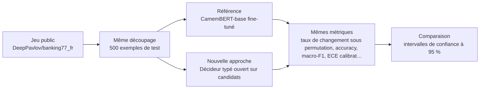
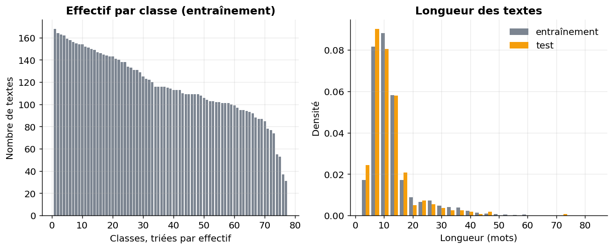
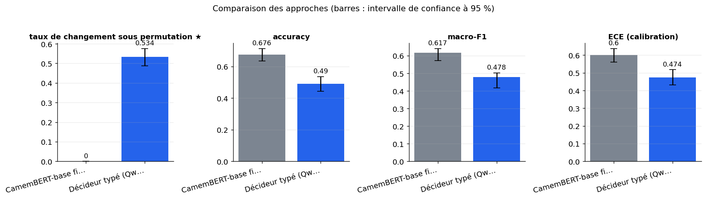
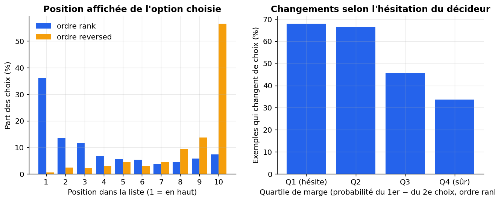
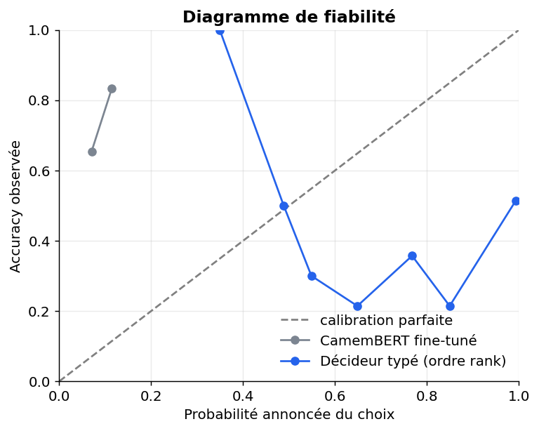

# Un décideur typé (choix parmi options, probabilité lue) est-il aussi précis et aussi stable qu'un CamemBERT fine-tuné quand on change l'ordre, les étiquettes ou le texte annexe ?

> **En bref.** Le décideur typé ouvert est très sensible à l'ordre des options, alors que CamemBERT reste stable sous permutation. L'écart de précision dépend de l'ordre et d'une référence probablement sous-entraînée, donc il est à relativiser. taux de changement sous permutation : 0,534 [0,488 ; 0,576] pour Décideur typé (Qwen/Qwen3-1.7B), contre 0 [0 ; 0] pour CamemBERT-base fine-tuné (500 exemples de test, échelle complète).

## Sommaire

1. [La question](#la-question)
2. [Le protocole](#le-protocole)
3. [Les résultats](#les-résultats)
4. [Ce qu'il faut retenir](#ce-quil-faut-retenir)
5. [Rejouer l'expérience](#rejouer-lexpérience)
6. [Contenu du dépôt](#contenu-du-dépôt)
7. [Références](#références)
8. [Glossaire](#glossaire)

## La question

On se demande si un modèle de langage utilisé comme décideur typé est aussi fiable qu'un classifieur classique entraîné, CamemBERT, pour ranger des demandes clients françaises parmi 77 intentions proches. Le décideur répond comme à un QCM : il reçoit la demande et dix intentions candidates, et l'on lit directement la probabilité qu'il donne à chaque case. On mesure sa précision, mais surtout s'il change d'avis quand on change seulement l'ordre des options. Le même test est mesuré sur la chaîne de CamemBERT. Si le décideur est précis mais change souvent d'avis, il ne peut pas servir seul à router des demandes, et le classifieur entraîné reste la référence.

**Hypothèse testée.** Sur 77 intentions françaises proches, un décideur typé ouvert (Qwen3-1.7B, choix parmi 10 candidats) atteint au plus 5 points d'accuracy de moins que CamemBERT fine-tuné, mais change de décision sur plus de 5 % des exemples quand l'ordre des options est permuté, alors que CamemBERT a 0 % par construction.

| | Référence | Nouvelle approche |
|---|---|---|
| **Approche** | CamemBERT-base fine-tuné | Décideur typé ouvert sur candidats |
| **Principe** | Classifieur d'intentions à 77 classes, tête de classification sur CamemBERT-base, entraîné sur le jeu d'entraînement complet. Déterministe, insensible à l'ordre des classes. | Proxy ouvert d'un modèle de décision typé : un LLM instruct reçoit le texte et 10 options étiquetées, et rend la distribution de probabilité sur le symbole de l'option (réponse typée, sans texte généré). Les 10 candidats viennent du top-10 de CamemBERT. On mesure précision, calibration et changement de décision sous permutation. |
| **Mise en œuvre** | transformers AutoModelForSequenceClassification, almanach/camembert-base, 3 époques, lr 3e-5, batch 32, longueur max 64, 10 % du train en validation pour choisir l'époque ; évaluation sur sous-échantillon fixe du test. | transformers AutoModelForCausalLM en bfloat16, prompt de choix, une seule passe avant, softmax sur les logits des symboles A–J (ou 0–9) au dernier token ; chat template sans mode réflexion. Variantes : ordre par rang, ordre inversé, ordre aléatoire, étiquettes chiffres, texte annexe neutre ajouté. Noms de classes issus de mteb/banking77 (label_text, anglais, underscores remplacés par espaces). Les services typés propriétaires ne sont pas testés : seul leur principe l'est. |
| **Modèles** | [`almanach/camembert-base`](https://huggingface.co/almanach/camembert-base) | [`Qwen/Qwen3-1.7B`](https://huggingface.co/Qwen/Qwen3-1.7B) |

## Le protocole



- **Données** : [`DeepPavlov/banking77_fr`](https://huggingface.co/datasets/DeepPavlov/banking77_fr) (configuration `default`), évaluation sur le découpage `test` (500 exemples). Requêtes françaises de clients, 77 intentions fines et proches (carte, virement, frais) : le plus proche substitut public de la classification à nombreuses classes proches, avec effectifs suffisants pour fine-tuner un encodeur.
- **Écarts avec des données réelles** : Une seule couche d'intentions (pas d'arbre motif/sous-motif) ; traduction automatique ; textes courts sans e-mails ni pièces jointes ; 77 classes contre ~300 ; noms de classes en anglais ; licence du jeu non précisée sur le Hub (original CC BY 4.0) ; le décideur typé est un proxy ouvert, pas Jev ni Clef.
- **Déroulé** : Le train de DeepPavlov/banking77_fr est découpé à 90/10 (entraînement/validation, stratifié) pour fine-tuner CamemBERT-base ; la meilleure époque est choisie sur la validation. Le test est un sous-échantillon aléatoire fixe de 500 exemples (150 à l'échelle réduite), le même pour les deux approches. Les 10 intentions les plus probables pour CamemBERT servent d'options au décideur Qwen3, qui fait une seule passe avant par présentation ; sa décision est le softmax sur les logits des symboles. On mesure l'accuracy, le macro-F1, l'ECE, le rappel du top-10 et le taux de changement sous les trois ordres (rang, inversé, aléatoire). Ce taux est mesuré aussi pour CamemBERT, en relançant sa chaîne sous chaque ordre. Les intervalles de confiance sont obtenus par bootstrap ; s'y ajoutent un test de McNemar apparié, un prédicteur trivial et un contrôle positif sur des cas faciles.
- **Deux échelles, un seul code** : l'échelle réduite (150 exemples, CPU, 11 min) valide la mécanique ; l'échelle complète (GPU T4 (Google Colab), 6 min) donne les résultats.



*À gauche, le nombre de textes d'entraînement par classe, trié par ordre décroissant (une barre = une intention). À droite, la distribution de la longueur des textes en mots, à l'entraînement et au test : deux courbes proches veulent dire que le test ressemble à l'entraînement.*

**Les métriques**

| Métrique | Ce qu'elle mesure | Meilleur si |
|---|---|---|
| taux de changement sous permutation ★ | Part des exemples dont le choix n'est pas le même sous les ordres rang, inversé et aléatoire des options. | plus bas |
| accuracy | Part des demandes rangées dans la bonne intention (présentation par rang pour le décideur). | plus haut |
| macro-F1 | Moyenne du F1 de chaque intention, pour que les intentions rares comptent autant que les fréquentes. | plus haut |
| ECE (calibration) | Écart moyen entre la probabilité annoncée du choix et la part de réponses réellement justes. | plus bas |
| rappel du top-10 (plafond) | Part des exemples dont la bonne intention figure parmi les 10 candidats de CamemBERT, plafond du décideur. | plus haut |
| sorties invalides | Part des réponses du décideur illisibles ou en échec, comptées comme erreurs (sans objet pour CamemBERT). | plus bas |
| accuracy, pire présentation | Accuracy de la présentation la moins favorable parmi celles testées. | plus haut |
| accuracy, meilleure présentation | Accuracy de la présentation la plus favorable ; son écart avec la pire montre la dépendance à la mise en page. | — |

★ métrique principale : c'est elle qui tranche la question.

## Les résultats

| Approche | taux de changement sous permutation ★ ↓ | accuracy ↑ | macro-F1 ↑ | ECE (calibration) ↓ | rappel du top-10 (plafond) ↑ | sorties invalides ↓ | accuracy, pire présentation ↑ | accuracy, meilleure présentation | Latence médiane (ms) ↓ |
|---|---|---|---|---|---|---|---|---|---|
| CamemBERT-base fine-tuné (référence) | **0 [0 ; 0]** | **0,676 [0,636 ; 0,714]** | **0,617 [0,572 ; 0,641]** | 0,6 [0,56 ; 0,638] | 0,954 [0,934 ; 0,97] | — | **0,544** | 0,676 | 12,6 |
| Décideur typé (Qwen/Qwen3-1.7B) (nouvelle approche) | 0,534 [0,488 ; 0,576] | 0,49 [0,444 ; 0,536] | 0,478 [0,418 ; 0,503] | **0,474 [0,431 ; 0,518]** | 0,954 [0,934 ; 0,97] | 0 [0 ; 0] | 0,436 | 0,652 | 55,4 |

★ métrique principale · ↑ plus haut = meilleur · ↓ plus bas = meilleur · entre crochets : intervalle de confiance à 95 % (bootstrap) · en gras : la meilleure valeur.



*Valeur de chaque métrique par approche (★ : métrique principale, à minimiser) ; les barres d'erreur donnent l'intervalle de confiance à 95 % sur 500 exemples de test.*



*À gauche : part des choix du décideur à chaque position affichée, en ordre rank et en ordre inversé. Deux profils en miroir signifient que le choix suit le contenu. À droite : part des exemples dont le choix change sous permutation, par quartile de marge de décision (Q1 = le décideur hésite le plus).*



*Accuracy observée en fonction de la probabilité annoncée, par tranches de 0,1. Plus une courbe est proche de la diagonale, mieux les probabilités sont calibrées ; sous la diagonale, le modèle est trop confiant.*

**Lecture** (confiance moyenne). À l'échelle complète (500 exemples de test, GPU), le décideur typé change de choix sur 53,4 % des exemples [48,8 ; 57,6] quand l'ordre des options varie, contre 0 % pour CamemBERT. Ce résultat est net et bien au-dessus du seuil de 5 %. Il ne vient pas du bruit, puisque les appels répétés à l'identique donnent 0 %. En accuracy, le décideur atteint 0,49 en ordre du rang contre 0,676 pour CamemBERT, mais 0,652 en ordre inversé : l'écart dépend fortement de l'ordre. CamemBERT, probablement sous-entraîné (ECE de 0,60), perd lui aussi plus de dix points avec la note neutre. À l'échelle réduite, la référence était presque non entraînée et le décideur la dépassait, ce qui confirme que l'écart dépend de son niveau d'entraînement. Le protocole diffère de la source (77 classes, proxy ouvert) : on retrouve la sensibilité à la présentation, sans chiffres comparables.

## Ce qu'il faut retenir

**Réserves**

- CamemBERT est probablement sous-ajusté. L'écart de précision réel avec un classifieur correctement entraîné est sans doute plus grand que celui mesuré, et le rappel du top-10 est probablement sous-estimé.
- L'écart de précision n'a pas de valeur unique. Il va d'environ 19 points (ordre du rang) à environ 2 points (ordre inversé), ce qui est en soi un signe de sensibilité à la présentation. Le chiffre d'accuracy affiché est le pire cas d'ordre.
- CamemBERT n'est stable que sous permutation des options. Un texte annexe sans rapport lui coûte plus de dix points d'accuracy, donc la stabilité de la référence est moins nette que le 0 % affiché.
- Ne pas conclure que le décideur est mieux calibré que CamemBERT. Les deux ECE ne mesurent pas la même chose, et le décideur est en réalité très sur-confiant.
- Le taux de changement mesuré vaut pour ce petit modèle ouvert et ce prompt. Il confirme la sensibilité à l'ordre dans ce cas, mais ne dit rien de précis sur les services propriétaires audités dans la source.

**Limites**

- Le décideur typé est un proxy ouvert (Qwen3) ; les services propriétaires étudiés par la source ne sont pas testés.
- Les noms d'intention sont en anglais, alors que les demandes sont en français et issues d'une traduction automatique, ce qui peut pénaliser le décideur.
- Les candidats viennent du top-10 de CamemBERT : le décideur dépend de la référence, et son accuracy est bornée par ce rappel.
- Le taux de changement de CamemBERT ne mesure que le bruit numérique et l'ordre de lecture des candidats : il est attendu proche de 0, car son entrée ne contient pas les options.
- À l'échelle réduite, une référence peu entraînée et un petit décideur sur 150 exemples donnent des intervalles larges ; seule l'échelle complète permet de trancher.

**Pistes d'amélioration**

- Les écarts de macro-F1 sont bruités et ne doivent pas être sur-interprétés. L'accuracy du classifieur pourrait varier d'une graine d'entraînement à l'autre.
- La latence du décideur (55 ms) s'ajoute à celle de CamemBERT (13 ms) puisqu'il dépend de ses candidats : le pipeline est plus lent que le chiffre affiché.

## Rejouer l'expérience


### Sur le jeu public

```bash
pip install -r requirements.txt
jupyter lab experiment.ipynb
```

Dans la cellule de paramètres : `PHASE = "public"`, puis `SCALE = "reduced"` (quelques minutes sur CPU, pour vérifier) ou `SCALE = "full"` (résultats publiés ; GPU T4 (Google Colab), 6 min). Les résultats sont écrits dans `outputs/results_public.json`, les figures dans `outputs/figures/` (les résultats publiés en sont une copie, dans `results/` et `figures/`).

### Sur vos données (environnement de services financiers)

Le même protocole, sur vos données, dans votre environnement : seule la cellule `PRIVATE_CONFIG` s'adapte. Le code de cette phase a été exécuté de bout en bout sur un jeu factice écrit comme un vrai export (dossier de fichiers, CSV « ; » en Windows-1252, colonnes à faire correspondre), contre un service simulé à la convention OpenAI (clé lue dans un fichier de secret), modèles chargés hors ligne.

**1. Préparer le jeu de données.** Colonnes attendues (les noms peuvent différer : on les fait correspondre dans `PRIVATE_CONFIG["columns"]`) :

| Colonne attendue | Type | Contenu |
|---|---|---|
| `text` | string | Texte du message ou de la demande client, anonymisé |
| `reason` | string | Motif de premier niveau (étiquette de référence) |
| `sub_reason` | string | Sous-motif (étiquette de référence, feuille de l'arbre) |
| `sub_reason_description` | string | Libellé ou description courte du sous-motif, présentée comme option au décideur |
| `received_at` | datetime | Date de réception, pour le découpage temporel |

Volume conseillé : 20 000 textes étiquetés, au moins 30 par sous-motif, et 3 000 textes de test.

**Conditions pour que la comparaison soit concluante**

- Étiquettes issues d'une annotation double avec accord inter-annotateurs (kappa) mesuré sur au moins 500 textes.
- Au moins 30 textes par sous-motif dans l'entraînement et 10 dans le test ; classes rares rapportées à part.
- Découpage temporel : test sur la période la plus récente, sans chevauchement de clients avec l'entraînement.
- Anonymiser noms, IBAN, numéros de carte et adresses avant toute extraction.
- Fournir un libellé et une description française par sous-motif, identiques pour tous les modèles.
- Exclure les textes multi-motifs non tranchés et les messages automatiques.
- Couvrir au moins 12 mois pour inclure la saisonnalité.

**Constituer l'extraction.** Extraire les demandes entrantes traitées sur la période, joindre le motif et sous-motif validés par le conseiller ou le contrôle qualité, filtrer les textes vides ou automatiques, anonymiser, puis échantillonner de façon stratifiée par sous-motif en conservant la distribution naturelle dans le test.

**2. Rendre les modèles disponibles hors ligne** (si l'environnement n'a pas accès à Internet) :

```bash
python download_models.py ./models --scale full   # sur un poste connecté
```

puis copier le dossier dans l'environnement et le désigner par `LOCAL_MODELS_DIR`. Les révisions téléchargées sont celles des résultats publiés.

**3. Configurer** l'environnement du notebook à partir de `private.env.example` (ou directement la cellule `PRIVATE_CONFIG`). Jamais de clé dans le notebook : une variable, un fichier de secret monté ou la saisie masquée.

| Variable | Rôle |
|---|---|
| `PRIVATE_DATA` | jeu de données : fichier ou dossier (csv, tsv, parquet, jsonl, json, xlsx) ; `fake` pour tester le code sur un jeu factice |
| `LOCAL_MODELS_DIR` | (facultatif) dossier des poids copiés localement (`org--nom/`), pour travailler sans Internet |
| `LLMAAS_BASE_URL, LLMAAS_MODEL` | service LLM interne à la convention OpenAI (URL en `/v1`, nom du modèle) |
| `LLMAAS_API_KEY ou LLMAAS_API_KEY_FILE` | clé du service, par variable ou par fichier de secret monté |
| `<SERVICE>_HEADERS` | (facultatif) en-têtes HTTP exigés par la passerelle, objet JSON |
| `HTTPS_PROXY, SSL_CERT_FILE, PIP_INDEX_URL` | (facultatif) proxy, autorité de certification et miroir PyPI d'entreprise |
| `SERVICE_TIMEOUT_S, SERVICE_MAX_RETRIES` | (facultatif) délai (120 s) et tentatives (3) par appel de service |

**4. Lancer** avec `PHASE = "private"` (et `SCALE = "full"`). La cellule d'initialisation affiche une liste de contrôle (jeu, colonnes, modèles, services) et s'arrête sur ce qui manque, avant tout calcul. Les résultats sont écrits dans `outputs/results_private.json` (avec versions, machine, graine et empreinte des données).

**5. Interpréter.** Métriques métier à suivre : Taux de routage correct au niveau sous-motif, cohérence motif/sous-motif, part de décisions modifiées par une permutation des options, ECE.

**Garde-fous.** Ne pas retenir un décideur typé dont le taux de changement sous permutation dépasse un seuil validé avec les métiers ; garder CamemBERT en référence ; aucune donnée client hors environnement cible. En phase `private`, le notebook refuse les services publics (OpenAI, Anthropic, Mistral, Hugging Face…) et le HTTP non chiffré, n'affiche aucune donnée brute et coupe la télémétrie des bibliothèques ; avec `LOCAL_MODELS_DIR`, il travaille sans accès à Internet.

## Contenu du dépôt

| Fichier | Contenu |
|---|---|
| `experiment.ipynb` | le notebook : question, données, deux approches, évaluation, analyse, bilan (sorties incluses) |
| `helpers.py` | fonctions communes : phases et échelles, services internes, lecture des données, mesures, figures |
| `results/results.json` | résultats publiés (échelle complète) : métriques, intervalles, latences, versions et machine |
| `results/results_reduced_scale.json` | résultats de l'échelle réduite (validation de la mécanique, CPU) |
| `figures/` | figures du notebook reprises dans ce README |
| `requirements.txt` | versions exactes des bibliothèques utilisées |
| `private.env.example` | variables d'environnement pour exécuter le notebook sur vos données |
| `download_models.py` | téléchargement des poids des modèles, pour un environnement sans Internet |

## Références

**Sources de l'approche**

- [Presentation Sensitivity in Typed Decision Models for Subjective Text Evaluation](https://arxiv.org/abs/2611.06384)

**Autres jeux de données examinés**

| Jeu | Accès | Intérêt | Pourquoi pas ici |
|---|---|---|---|
| [mteb/amazon_massive_intent](https://huggingface.co/datasets/mteb/amazon_massive_intent) | Hugging Face, libre | 60 intentions françaises en arbre à 2 niveaux (apache-2.0). | Domaine hors entreprise et classes plus séparables ; à garder pour une suite sur la cohérence hiérarchique. |
| [DeepPavlov/clinc150_fr](https://huggingface.co/datasets/DeepPavlov/clinc150_fr) | Hugging Face, libre | 150 classes françaises, étiquettes entières sans noms. | Pas de noms de classes ni de licence affichée ; table de correspondance à reconstituer. |
| [mteb/MTOPIntentClassification](https://huggingface.co/datasets/mteb/MTOPIntentClassification) | Hugging Face, libre | ~113 intentions déséquilibrées en français. | Licence unknown, pas de noms de classes, domaine assistant vocal. |
| [BenGaia/avis-clients](https://huggingface.co/datasets/BenGaia/avis-clients) | Hugging Face, libre | 15 000 avis français notés de 1 à 10. | Ne teste que la notation, pas la classification à classes nombreuses. |
| [DecisionBench](https://www.deeplearning.ai/the-batch/models-built-to-do-one-thing-well) | sur demande | 43 tâches de décision typée, calibration incluse, selon ses promoteurs. | Aucun jeu téléchargeable confirmé ; à suivre. |

**Licences**

- Jeu de données `DeepPavlov/banking77_fr` : voir sa fiche
- `almanach/camembert-base` : mit
- `Qwen/Qwen3-1.7B` : apache-2.0
- `Qwen/Qwen3-0.6B` : apache-2.0
- Vérifier la licence de chaque modèle avant tout usage au-delà de l'évaluation.

## Glossaire

| Terme | Définition |
|---|---|
| **Décideur typé** | Modèle qui rend un choix parmi des options fixées, avec une probabilité, au lieu d'un texte libre. |
| **Fine-tuning** | Réentraînement d'un modèle pré-entraîné sur des exemples étiquetés de la tâche visée. |
| **Logit et softmax** | Le logit est un score brut par option ; le softmax transforme ces scores en probabilités qui somment à 1. |
| **Présentation** | Manière d'afficher les options (ordre, symboles, note annexe) sans changer le contenu à juger. |
| **Taux de changement sous permutation** | Part des exemples dont le choix change quand on réordonne seulement les options. |
| **Calibration (ECE)** | Accord entre la probabilité annoncée et la fréquence réelle de bonnes réponses ; l'ECE mesure l'écart moyen. |
| **Bootstrap** | On retire des exemples au hasard avec remise pour voir à quel point un chiffre dépend de l'échantillon. |
| **Test de McNemar** | Test apparié qui regarde les exemples où une seule des deux approches a raison. |
| **Contrôle positif** | Série de cas faciles qui vérifie que le décideur comprend le format avant de juger ses résultats. |
